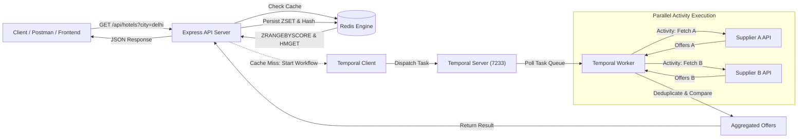

# 01. Project Overview — Hotel Offer Orchestrator

## 1. Executive Summary

The **Hotel Offer Orchestrator** is an enterprise-grade backend aggregation engine built using **Node.js**, **TypeScript**, **Express**, **Temporal.io**, and **Redis**. 

Modern travel aggregators (such as Expedia, Kayak, or Booking.com) interact with numerous third-party supplier distribution systems (Global Distribution Systems, bed banks, and direct hotel APIs). These suppliers offer overlapping hotel rooms with disparate pricing models, fluctuating commission margins, and different naming conventions.

This project implements a resilient distributed system that:
1. Concurrently fetches hotel room offers across multiple suppliers.
2. Normalizes entity identities and eliminates duplicate offerings.
3. Automatically selects the most economical offer for each hotel property, adhering to deterministic tie-breaking criteria.
4. Caches deduplicated data in Redis and leverages Redis Sorted Sets (`ZSET`) for sub-millisecond price-range queries directly in the database engine.
5. Employs Temporal.io workflow orchestration to guarantee execution durability, automatic retries, timeout management, and complete operational visibility.

---

## 2. Business Problem & Requirements

### The Business Challenge
In hospitality technology:
- **Redundant Inventory**: Different suppliers list the exact same physical property under slightly varied names (e.g. `"Holtin"`, `"  holtin  "`, `"TAJ PALACE"` vs `"Taj Palace"`).
- **Price Disparities**: Supplier A might offer a room at ₹6,000 with a 10% commission, while Supplier B offers the same room at ₹5,340 with a 20% commission. The aggregator must present the cheapest customer-facing price while tracking supplier-specific commissions.
- **Supplier Latency & Volatility**: Third-party APIs frequently experience network blips, intermittent timeouts, and rate limits. A simple in-process HTTP call will either block the client or drop transient errors.
- **Query Performance**: End-users frequently filter search results by price ranges (e.g., ₹5,000 to ₹7,000). Filtering thousands of records in Node.js application memory wastes CPU and degrades event-loop responsiveness.

### Functional Requirements
- **Mock Supplier Endpoints**: Independent mock endpoints for Supplier A (`GET /supplierA/hotels`) and Supplier B (`GET /supplierB/hotels`) delivering realistic hotel inventories for multiple cities (Delhi, Mumbai).
- **Orchestrated Hotel Aggregation**: Main endpoint (`GET /api/hotels?city=delhi`) that invokes a Temporal workflow to trigger parallel supplier requests.
- **Intelligent Deduplication**: Trimming and case-insensitive matching; selects lower price; breaks price ties deterministically by selecting Supplier A; preserves offer commission percentage and supplier name without mixing; eliminates internal identifiers (`hotelId`, `city`).
- **Redis Price Filtering**: High-performance filtering via Redis Sorted Sets (`hotels:{city}:prices`) and Hashes (`hotels:{city}:data`) using `ZRANGEBYSCORE`. Filtering must happen in Redis, not in JavaScript memory.
- **Cache Management**: Subsequent queries for a cached city must hit Redis directly without re-invoking suppliers or Temporal. Old sorted set entries must be atomically purged on cache refresh.
- **Comprehensive Health Checks**: `GET /health` with real-time connectivity validation for Redis, Temporal, Supplier A, and Supplier B.

### Non-Functional Requirements
- **Fault Tolerance**: Resilient workflow execution with exponential backoffs and retry limits.
- **Determinism**: Workflows must remain purely deterministic, delegating all network I/O to activities.
- **Low Latency**: Concurrent activity execution minimizes overall aggregation turnaround.
- **Type Safety**: 100% strict TypeScript types with zero `any` shortcuts.

---

## 3. Technology Stack & Selection Rationale

| Technology | Role | Why It Was Chosen |
| :--- | :--- | :--- |
| **Node.js (v20+)** | Runtime Platform | Non-blocking, event-driven asynchronous I/O ideal for high-throughput aggregation gateways. |
| **TypeScript (v5.7)** | Language | Compile-time type verification, rich interface contracts, and protection against undefined property runtime bugs. |
| **Express.js (v5)** | Web Framework | Lightweight, battle-tested HTTP routing, middleware pipeline, and predictable controller abstractions. |
| **Temporal.io** | Distributed Orchestrator | Guarantees durable execution, handles transient supplier retries, enforces timeouts, maintains an immutable event history, and decouples workflow orchestration from API handlers. |
| **Redis (v7) & ioredis** | Cache & Price Engine | In-memory key-value database providing native Sorted Sets (`ZSET`). Scores represent prices, enabling $O(\log N + M)$ range filtering directly in Redis memory. |
| **Docker & Compose** | Containerization | Standardized environment reproducibility across development, testing, and production. |
| **Jest & supertest** | Quality Assurance | Rigorous unit, integration, and HTTP lifecycle testing framework. |

---

## 4. High-Level Architecture & Flow

### Component Responsibilities:
1. **Client**: Issues HTTP requests specifying query filters (`city`, `minPrice`, `maxPrice`).
2. **Express API**: Handles HTTP routing, request validation, cache interrogation, and response serialization.
3. **Temporal Client & Server**: Manages workflow scheduling, state persistence, event histories, and activity task dispatches.
4. **Temporal Worker**: Listens to the `hotel-offers-queue`, executing activities and workflow orchestration in a dedicated, isolated execution context.
5. **Supplier Activities**: Encapsulate outgoing HTTP calls with defined retry policies and timeouts.
6. **Comparison Engine**: Performs case-insensitive entity normalization, price comparison, tie-breaking, and data scrubbing.
7. **Redis Storage**: Stores price indices in Sorted Sets and full serialized entities in Hashes, executing `ZRANGEBYSCORE` filters in $O(\log N + M)$ time.
