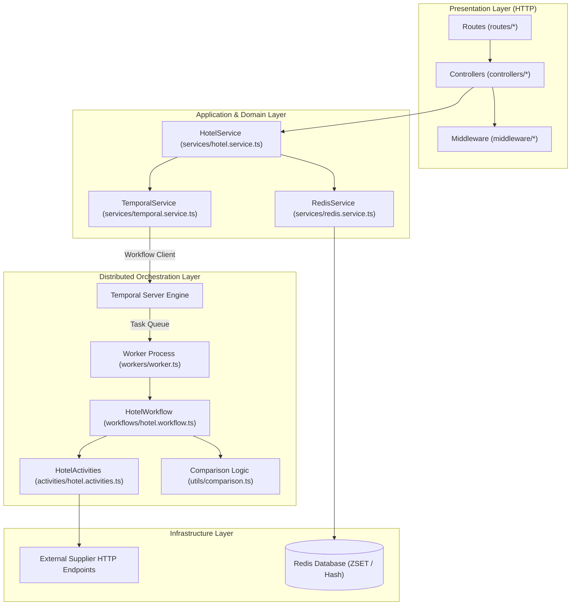

# 02. Project Structure & Code Organization

## 1. Directory Tree

```
hotel-offer/
├── Dockerfile                      # Multi-stage production container build
├── docker-compose.yml              # Local multi-service topology orchestration
├── package.json                    # Dependencies, scripts, and project metadata
├── package-lock.json               # Locked dependency tree
├── tsconfig.json                   # TypeScript compiler configuration (ES2022, Node16)
├── jest.config.js                  # Jest test runner configuration
├── .env.example                    # Environment variable template
├── .gitignore                      # Git ignored files and directories
├── postman/
│   └── Hotel-Offer-Orchestrator.postman_collection.json # Comprehensive Postman collection
├── docs/                           # Exhaustive technical documentation suite
│   ├── README.md                   # Documentation index & coverage checklist
│   ├── 01-project-overview.md
│   ├── 02-project-structure.md
│   ├── 03-system-architecture.md
│   ├── 04-complete-workflow.md
│   ├── 05-temporal-deep-dive.md
│   ├── 06-redis-deep-dive.md
│   ├── 07-dependencies-and-technology.md
│   ├── 08-api-reference.md
│   ├── 09-data-model-and-business-logic.md
│   ├── 10-docker-and-deployment.md
│   ├── 11-testing-and-debugging.md
│   ├── 12-code-walkthrough.md
│   └── 13-interview-preparation.md
├── src/                            # Application TypeScript source code
│   ├── app.ts                      # Express application setup & middleware assembly
│   ├── server.ts                   # HTTP server lifecycle & process bootstrap
│   ├── config/
│   │   └── env.ts                  # Centralized, strongly-typed environment config
│   ├── types/
│   │   └── hotel.types.ts          # Core TypeScript contracts, interfaces, and enums
│   ├── utils/
│   │   ├── comparison.ts           # Deduplication, normalization, and tie-breaking logic
│   │   ├── validation.ts           # Query parameter validation & custom ValidationError
│   │   └── logger.ts               # Structured logging utility with level filtering
│   ├── suppliers/
│   │   ├── supplierA.data.ts       # Realistic mock inventory for Supplier A
│   │   └── supplierB.data.ts       # Realistic mock inventory for Supplier B
│   ├── services/
│   │   ├── redis.service.ts        # Redis client, pipeline operations, ZSET filtering
│   │   ├── temporal.service.ts     # Temporal Client connection & workflow execution
│   │   └── hotel.service.ts        # Main orchestration coordinator between Redis & Temporal
│   ├── activities/
│   │   └── hotel.activities.ts     # Temporal activity definitions for supplier HTTP fetches
│   ├── workflows/
│   │   └── hotel.workflow.ts       # Deterministic Temporal workflow orchestration
│   ├── workers/
│   │   └── worker.ts               # Temporal Worker process hosting workflows & activities
│   ├── controllers/
│   │   ├── hotel.controller.ts     # Express controller for /api/hotels
│   │   ├── supplier.controller.ts  # Express controller for mock supplier endpoints
│   │   └── health.controller.ts    # Express controller for /health connectivity checks
│   ├── routes/
│   │   ├── index.ts                # Master route aggregation
│   │   ├── hotel.routes.ts         # Routes for hotel queries
│   │   ├── supplier.routes.ts      # Routes for supplier mocks
│   │   └── health.routes.ts        # Routes for system health
│   └── middleware/
│       └── error.middleware.ts     # Centralized error handler and exception mapper
└── tests/                          # Automated Jest test suites
    ├── activities.test.ts          # Activity fetch and error handling tests
    ├── api.integration.test.ts     # Supertest end-to-end HTTP integration tests
    ├── comparison.test.ts          # Deduplication, casing, and tie-breaking tests
    ├── hotel.service.test.ts       # Service orchestration and cache hit/miss tests
    ├── redis.service.test.ts       # Redis Sorted Set price filtering tests (ioredis-mock)
    ├── validation.test.ts          # Query parameter validation edge case tests
    └── workflow.test.ts            # Temporal workflow concurrency and failure tests
```

---

## 2. Architectural Layers & Separation of Concerns

The codebase adheres strictly to layered architecture and clean separation of concerns:



### Module Responsibilities:
1. **Routes (`src/routes/`)**: Map incoming HTTP verbs and URL paths to their corresponding controller methods. No business logic resides here.
2. **Controllers (`src/controllers/`)**: Extract and validate input query parameters, invoke appropriate service methods, and translate service results into HTTP responses (including HTTP status codes and headers like `X-Cache`).
3. **Services (`src/services/`)**: High-level application use-cases. Coordinates cache lookups with background workflow triggers.
4. **Workflows (`src/workflows/`)**: Pure, deterministic orchestration logic executed inside Temporal's sandboxed environment. Workflows manage concurrency (`Promise.all`), activity invocation, and result aggregation.
5. **Activities (`src/activities/`)**: Side-effecting, non-deterministic operations. All external HTTP requests to suppliers live strictly inside activities, protected by retry policies and timeout budgets.
6. **Utils (`src/utils/`)**: Pure utility functions, domain normalization algorithms, and parameter validation helpers.
7. **Workers (`src/workers/`)**: Standalone daemon process that registers workflows and activities with Temporal, continuously polling task queues for incoming execution requests.

---

## 3. Detailed File Responsibilities

### `src/types/hotel.types.ts`
- **Why it exists**: Provides single-source-of-truth TypeScript interfaces for suppliers, aggregated outputs, and queries.
- **Exports**: `SupplierHotelOffer`, `AggregatedHotelOffer`, `HotelQueryParams`, `HealthStatus`, `SupplierErrorDetails`.
- **Imports**: None.
- **Depended on by**: Almost all services, controllers, workflows, and test files.

### `src/utils/comparison.ts`
- **Why it exists**: Implements core domain logic: case-insensitive name deduplication, price comparison, tie-breaking, and scrubbing internal fields.
- **Exports**: `normalizeHotelName(name: string): string`, `compareAndDeduplicateOffers(...)`.
- **Imports**: `SupplierHotelOffer`, `AggregatedHotelOffer` from `src/types/hotel.types`.
- **Depended on by**: `src/workflows/hotel.workflow.ts`, `src/services/redis.service.ts`, `tests/comparison.test.ts`.

### `src/utils/validation.ts`
- **Why it exists**: Validates incoming query parameters (`city`, `minPrice`, `maxPrice`) before execution reaches domain services.
- **Exports**: `ValidationError` class, `validateHotelQueryParams(...)`.
- **Imports**: `HotelQueryParams` from `src/types/hotel.types`.
- **Depended on by**: `src/controllers/hotel.controller.ts`, `tests/validation.test.ts`.

### `src/services/redis.service.ts`
- **Why it exists**: Encapsulates all interactions with the Redis in-memory database.
- **Exports**: `RedisService` class, singleton `redisService` instance.
- **Key Methods**:
  - `saveHotels(city, hotels)`: Atomically wipes old city keys and populates both Sorted Sets and Hashes via a pipeline.
  - `getHotelsByPriceRange(city, min, max)`: Executes `zrangebyscore` followed by `hmget`.
  - `hasCityCache(city)`: Determines cache presence in $O(1)$ time.
  - `isHealthy()`: Checks Redis availability using `PING`.

### `src/services/temporal.service.ts`
- **Why it exists**: Provides a client interface for the Express application to schedule workflows on Temporal Server.
- **Exports**: `TemporalService` class, singleton `temporalService` instance.
- **Key Methods**:
  - `getClient()`: Lazily instantiates the Temporal Connection and Client.
  - `executeAggregationWorkflow(city)`: Starts `aggregateHotelOffersWorkflow` and awaits completion.
  - `isHealthy()`: Queries Temporal system health.

### `src/services/hotel.service.ts`
- **Why it exists**: The primary coordinator for hotel offer lookups. Implements the cache-aside pattern: check Redis -> on hit, return; on miss, invoke Temporal -> save to Redis -> query Redis.
- **Exports**: `HotelService` class, singleton `hotelService`.
- **Depended on by**: `src/controllers/hotel.controller.ts`.

### `src/activities/hotel.activities.ts`
- **Why it exists**: Contains the actual HTTP fetch operations for Supplier A and Supplier B with logging, error capture, and format verification.
- **Exports**: `HotelActivities` interface, `createActivities()` factory, `activities` instance.
- **Depended on by**: `src/workers/worker.ts`, `src/workflows/hotel.workflow.ts`.

### `src/workflows/hotel.workflow.ts`
- **Why it exists**: Defines the Temporal workflow function. Runs Supplier A and Supplier B activities concurrently via `Promise.all` and aggregates their outputs.
- **Exports**: `aggregateHotelOffersWorkflow(city: string)`.

### `src/workers/worker.ts`
- **Why it exists**: Entry point for the Temporal Worker process. Connects to the Temporal cluster, registers workflows and activities, and executes background tasks.
