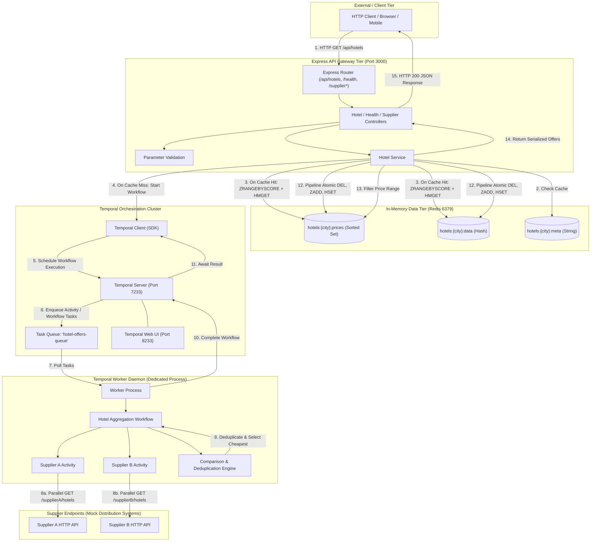
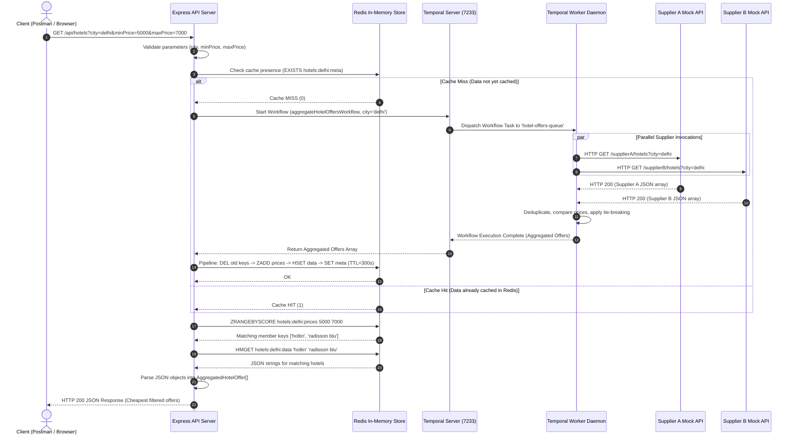
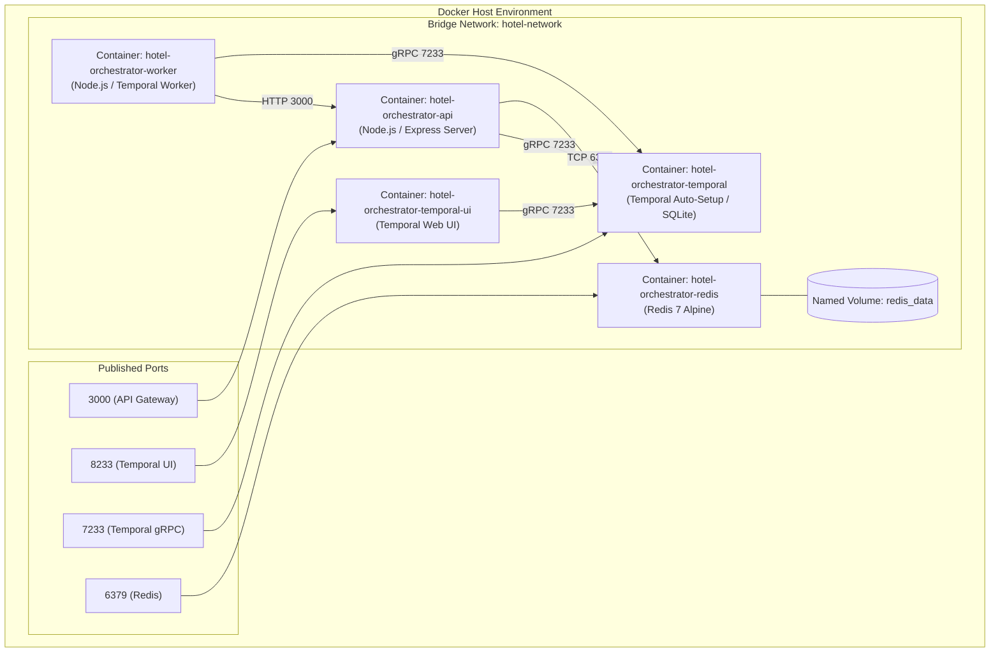
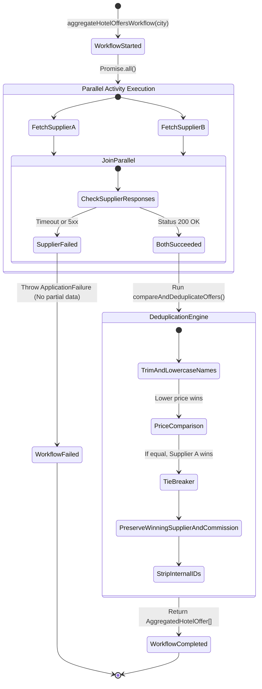

# 03. System Architecture

## 1. High-Level Architectural Overview

The **Hotel Offer Orchestrator** is designed as a distributed, decoupled aggregation system. It ensures high performance for read queries through in-memory Redis indexing while offloading complex, unreliable third-party supplier interactions to a durable orchestration engine (Temporal.io).



---

## 2. Component Interaction Architecture

The application cleanly segregates read queries from write-heavy workflow executions:



---

## 3. Runtime & Deployment Architecture

In production and Docker Compose environments, the system runs as five independent networked containers:



### Key Service Boundaries:
1. **API Service (`api`)**: Dedicated solely to serving user-facing HTTP requests. Does not execute workflows internally; acts only as a Temporal client.
2. **Worker Service (`worker`)**: Scales independently based on supplier activity volume. If supplier APIs slow down, worker containers can be horizontally scaled without impacting API server throughput.
3. **Temporal Service (`temporal`)**: Durable execution cluster managing execution histories and task distribution.
4. **Redis Service (`redis`)**: High-throughput memory store with persistent AOF (Append-Only File) storage.

---

## 4. Redis Storage Architecture

To achieve $O(\log N + M)$ price filtering without deserializing the entire inventory in Node.js memory, Redis uses a dual-structure storage model partitioned by city:

```mermaid
classDiagram
    class CityNamespace {
        +String hotels:{city}:meta
        +SortedSet hotels:{city}:prices
        +Hash hotels:{city}:data
    }

    class SortedSetPrices {
        Score: hotel.price (Double)
        Member: normalizeHotelName(hotel.name) (String)
    }

    class HashData {
        Field: normalizeHotelName(hotel.name) (String)
        Value: JSON.stringify(hotelObject) (String)
    }

    CityNamespace *-- SortedSetPrices : Price Index
    CityNamespace *-- HashData : Entity Payload
```

### Detailed Redis Keys:
- **`hotels:{city}:prices` (Sorted Set)**:
  - **Member**: Normalized hotel name (e.g., `'holtin'`, `'radisson blu'`). Guarantees unique entity representation.
  - **Score**: Winning offer price (e.g., `5340`, `5900`). Enables native `ZRANGEBYSCORE` filtering.
- **`hotels:{city}:data` (Hash)**:
  - **Field**: Normalized hotel name.
  - **Value**: Complete JSON string of the winning offer (`{"name":"Holtin","price":5340,"supplier":"Supplier B","commissionPct":20}`).
- **`hotels:{city}:meta` (String)**:
  - Stores cache metadata (`'cached'` or `'empty'`) with TTL to track cache validity.

---

## 5. Temporal Workflow Architecture



### Determinism Guarantee:
Temporal mandates that workflow code must be 100% deterministic. The workflow:
- Performs **no network I/O** directly.
- Performs **no disk or database reads/writes** directly.
- Generates **no unseeded random numbers or wall-clock timestamps**.
- Delegates external HTTP requests exclusively to `fetchSupplierAHotels` and `fetchSupplierBHotels` activities.
- Uses pure, deterministic JavaScript functions for deduplication and sorting.
