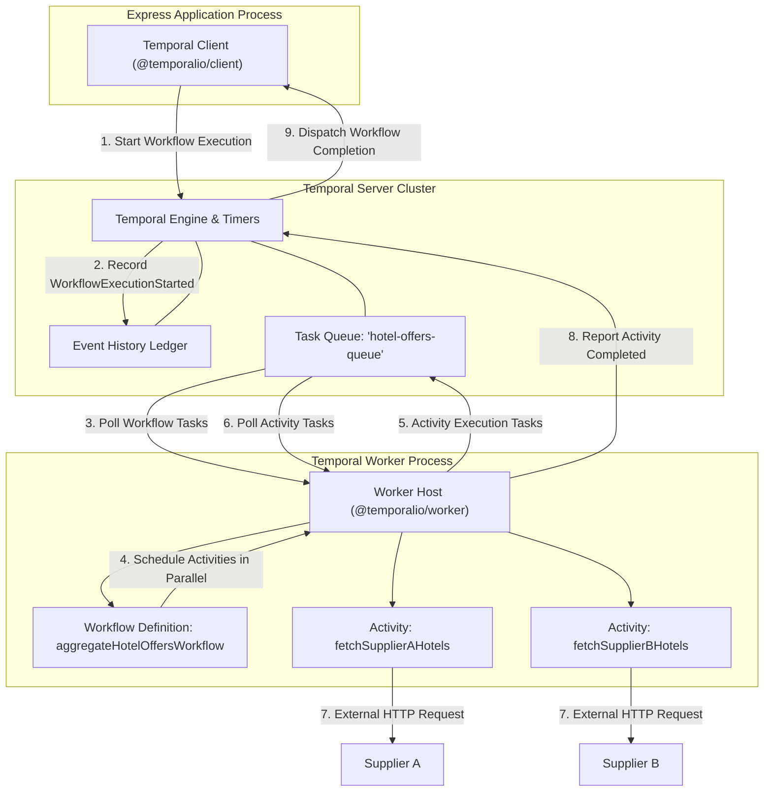

# 05. Temporal.io Deep Dive & Orchestration Architecture

## 1. What is Temporal.io?

**Temporal.io** is an open-source, developer-first durable execution engine. It enables developers to write complex, long-running, fault-tolerant business workflows as standard code while guaranteeing that the code executes to completion regardless of server crashes, network outages, or transient service failures.

In a traditional application, if a background process fails midway through calling external suppliers, state is lost, retries require manual queuing infrastructure, and transient errors result in dropped requests. Temporal abstracts state persistence, activity queues, retry backoffs, and execution tracking into an immutable append-only event ledger.

---

## 2. Core Temporal Concepts in This Project



### 1. Workflow vs. Activity
- **Workflow (`src/workflows/hotel.workflow.ts`)**:
  - The orchestrator.
  - Must be **strictly deterministic**. If replayed 10,000 times with the same event history, it must produce identical commands.
  - Must not perform direct network requests, read system clocks, or access external databases.
  - Orchestrates activities using `Promise.all`.
- **Activity (`src/activities/hotel.activities.ts`)**:
  - The side-effect executor.
  - Can be **non-deterministic** and perform arbitrary network I/O, database calls, or filesystem operations.
  - Handled with timeouts and retry policies.

### 2. Temporal Client (`src/services/temporal.service.ts`)
The bridge between Express and Temporal. Initiates workflows via:
```typescript
const handle = await client.workflow.start(aggregateHotelOffersWorkflow, {
  args: [city],
  taskQueue: config.temporal.taskQueue,
  workflowId: `hotel-aggregation-${city.toLowerCase()}-${randomUUID()}`,
});
const result = await handle.result();
```

### 3. Temporal Worker (`src/workers/worker.ts`)
A dedicated Node.js process listening on `hotel-offers-queue`. It downloads the compiled workflow code into a sandboxed V8 isolate and executes activity tasks.

---

## 3. Workflow Implementation & Determinism

### Workflow Code Walkthrough (`src/workflows/hotel.workflow.ts`)
```typescript
import { proxyActivities } from '@temporalio/workflow';
import type { HotelActivities } from '../activities/hotel.activities';
import { AggregatedHotelOffer } from '../types/hotel.types';
import { compareAndDeduplicateOffers } from '../utils/comparison';

const { fetchSupplierAHotels, fetchSupplierBHotels } = proxyActivities<HotelActivities>({
  startToCloseTimeout: '10s',
  retry: {
    initialInterval: '1s',
    backoffCoefficient: 2,
    maximumAttempts: 3,
  },
});

export async function aggregateHotelOffersWorkflow(city: string): Promise<AggregatedHotelOffer[]> {
  // Execute Supplier A and Supplier B activities concurrently
  const [supplierAOffers, supplierBOffers] = await Promise.all([
    fetchSupplierAHotels(city),
    fetchSupplierBHotels(city),
  ]);

  // Pure deterministic deduplication and price comparison
  return compareAndDeduplicateOffers(supplierAOffers, supplierBOffers);
}
```

### Why Determinism Matters:
During workflow execution, if a worker crashes, a new worker takes over. Temporal reconstructs the exact workflow state by **replaying** the history of completed activities without re-executing them. If the workflow contained non-deterministic logic (e.g. `Math.random()`, `Date.now()`, or direct `fetch()`), the replay would diverge, causing a fatal `DeterministicError`.

---

## 4. Activities & Retry Policies

### Activity Implementation (`src/activities/hotel.activities.ts`)
```typescript
export function createActivities(supplierAUrl: string, supplierBUrl: string): HotelActivities {
  return {
    async fetchSupplierAHotels(city: string): Promise<SupplierHotelOffer[]> {
      const url = `${supplierAUrl}?city=${encodeURIComponent(city)}`;
      logger.info(`[Activity] Fetching hotels from Supplier A: ${url}`);
      const response = await axios.get<SupplierHotelOffer[]>(url, { timeout: 5000 });
      return response.data;
    },
    // ... Supplier B
  };
}
```

### Retry Policy Configuration:
- `startToCloseTimeout: '10s'`: The maximum time an activity execution can take before being considered hung or failed.
- `initialInterval: '1s'`: First retry occurs after 1 second.
- `backoffCoefficient: 2`: Exponential backoff (`1s`, `2s`, `4s`).
- `maximumAttempts: 3`: Ensures failing suppliers do not tie up worker threads indefinitely.

---

## 5. Parallel Execution with `Promise.all`

Temporal workflows natively support asynchronous JavaScript concurrency:
```typescript
const [supplierAOffers, supplierBOffers] = await Promise.all([
  fetchSupplierAHotels(city),
  fetchSupplierBHotels(city),
]);
```

When this line executes:
1. Temporal schedules two distinct activity tasks: `ActivityTaskScheduled(fetchSupplierAHotels)` and `ActivityTaskScheduled(fetchSupplierBHotels)`.
2. Both tasks are delivered to workers simultaneously.
3. Workers initiate both HTTP calls in parallel.
4. Total execution time equals $\max(T_A, T_B) + T_{aggregation}$ rather than $T_A + T_B$.

---

## 6. Architectural Comparison: Temporal vs. In-Process `Promise.all`

| Dimension | Vanilla `Promise.all` in Express | Temporal Orchestration (This Project) |
| :--- | :--- | :--- |
| **Worker Decoupling** | API process performs all HTTP requests. Heavy supplier load exhausts API socket pools and CPU. | API process delegates tasks to a dedicated worker pool. The API remains responsive to incoming HTTP requests. |
| **Transient Retries** | Requires manual `while` loops, custom backoff timers, and error tracking in memory. | Declarative retry policies (`initialInterval`, `backoffCoefficient`, `maximumAttempts`) managed by the Temporal engine. |
| **Process Crash Recovery** | If Node.js restarts or crashes during a 10s supplier wait, all pending requests vanish. | Temporal resumes execution from the exact point of interruption on another worker without re-running completed steps. |
| **Observability** | Requires distributed tracing and custom log scraping. | Temporal Web UI (Port 8233) provides full visual execution trees, call inputs/outputs, activity durations, and stack traces. |
| **Rate Limiting & Backpressure** | Easy to overwhelm third-party APIs during traffic spikes. | Task Queues naturally buffer tasks, allowing workers to pull tasks at a controlled, configured concurrency rate. |
