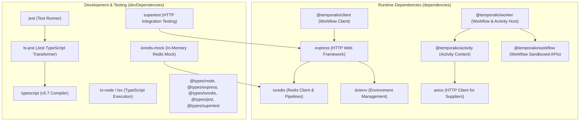

# 07. Dependencies & Technology Stack

This document details every library and runtime tool utilized in the **Hotel Offer Orchestrator**, providing clear rationale, usage sites, and architectural relationships.

---

## 1. Dependency Relationship Graph

---

## 2. Runtime Dependencies

### 1. `express` (^5.3.0)
- **Role**: Core HTTP server framework.
- **Why Needed**: Routing, middleware handling, request parsing, and error encapsulation.
- **Where Used**: `src/app.ts`, `src/routes/*`, `src/controllers/*`.
- **Key APIs**: `express()`, `Router()`, `req.query`, `res.status().json()`, `NextFunction`.

### 2. `@temporalio/client` (^1.26.0)
- **Role**: Client library to interact with Temporal Server over gRPC.
- **Why Needed**: Enables Express controllers/services to start and monitor workflow executions.
- **Where Used**: `src/services/temporal.service.ts`.
- **Key APIs**: `Connection.connect()`, `Client`, `client.workflow.start()`, `handle.result()`.

### 3. `@temporalio/worker` (^1.26.0)
- **Role**: Worker daemon runtime.
- **Why Needed**: Polls Temporal task queues, loads workflow bundles, and executes activities.
- **Where Used**: `src/workers/worker.ts`.
- **Key APIs**: `NativeConnection.connect()`, `Worker.create()`, `worker.run()`, `worker.shutdown()`.

### 4. `@temporalio/workflow` (^1.26.0)
- **Role**: Deterministic workflow runtime APIs.
- **Why Needed**: Proxies activities with retry policies and timeouts inside sandboxed workflow isolates.
- **Where Used**: `src/workflows/hotel.workflow.ts`.
- **Key APIs**: `proxyActivities<T>()`.

### 5. `@temporalio/activity` (^1.26.0)
- **Role**: Activity context and helper utilities.
- **Why Needed**: Defines activity signatures and failure representations.
- **Where Used**: `src/activities/hotel.activities.ts`.

### 6. `ioredis` (^5.11.1)
- **Role**: High-performance, robust Redis client for Node.js.
- **Why Needed**: Supports Redis Sorted Sets, Hashes, binary commands, and atomic pipelines.
- **Where Used**: `src/services/redis.service.ts`.
- **Key APIs**: `client.pipeline()`, `client.zrangebyscore()`, `client.hmget()`, `client.del()`, `client.exists()`.

### 7. `axios` (^1.21.1)
- **Role**: Promise-based HTTP client.
- **Why Needed**: Performs outbound HTTP requests to external supplier APIs with configurable timeouts.
- **Where Used**: `src/activities/hotel.activities.ts`, `src/controllers/health.controller.ts`.
- **Key APIs**: `axios.get(url, { timeout })`.

### 8. `dotenv` (^18.0.10)
- **Role**: Environment variable loader.
- **Why Needed**: Loads key-value pairs from `.env` into `process.env`.
- **Where Used**: `src/config/env.ts`.

---

## 3. Development & Testing Dependencies

### 1. `typescript` (^5.7.3)
- **Role**: Static type checker and transpiler.
- **Where Used**: Root build tooling (`npm run build`).

### 2. `tsx` (^4.23.15) & `ts-node` (^10.9.2)
- **Role**: Direct execution of TypeScript files without manual compilation steps.
- **Where Used**: Development commands (`npm run dev`, `npm run worker`).

### 3. `jest` (^30.5.2) & `ts-jest` (^29.4.15)
- **Role**: Automated test suite runner and TypeScript test pre-processor.
- **Where Used**: `tests/*`, `npm test`.

### 4. `supertest` (^7.3.2)
- **Role**: Fluent HTTP assertion library for Node.js servers.
- **Where Used**: `tests/api.integration.test.ts` to test Express routes without network bindings.

### 5. `ioredis-mock` (^8.13.1)
- **Role**: In-memory Redis simulation library.
- **Where Used**: `tests/redis.service.test.ts` and `tests/hotel.service.test.ts` to verify ZSET and Hash operations in isolated memory.

---

## 4. `package.json` Scripts Reference

| Script | Command | Purpose |
| :--- | :--- | :--- |
| `build` | `tsc` | Transpiles TypeScript from `src/` to production JavaScript in `dist/`. |
| `start` | `node dist/server.js` | Runs the compiled Express API server in production mode. |
| `dev` | `tsx watch src/server.ts` | Runs the API server locally with hot-reloading on file change. |
| `worker` | `tsx src/workers/worker.ts` | Runs the Temporal Worker locally from TypeScript source. |
| `worker:prod` | `node dist/workers/worker.js` | Runs the compiled Temporal Worker in production/Docker. |
| `test` | `jest` | Executes all 7 automated test suites across 46 unit & integration tests. |
| `test:coverage`| `jest --coverage` | Generates line, branch, and function code coverage reports. |
