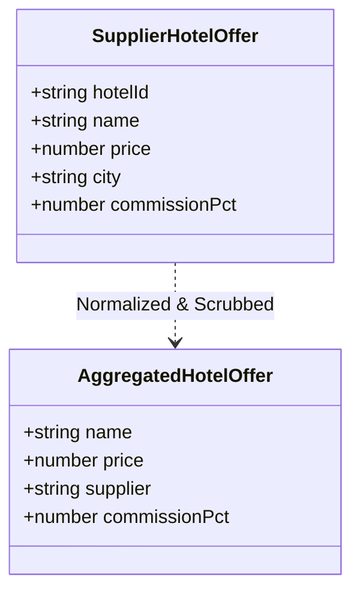

# 09. Data Models & Core Business Logic

## 1. Domain Entities & Type Definitions

The application enforces a strict separation between raw upstream supplier responses and customer-facing aggregated representations.



### TypeScript Interfaces (`src/types/hotel.types.ts`)
```typescript
export interface SupplierHotelOffer {
  hotelId: string;       // e.g., "a1", "b1" (internal supplier identifier)
  name: string;          // e.g., "Holtin", "TAJ PALACE"
  price: number;         // e.g., 5340
  city: string;          // e.g., "delhi"
  commissionPct: number; // e.g., 20
}

export interface AggregatedHotelOffer {
  name: string;          // e.g., "Holtin" (winning display name)
  price: number;         // e.g., 5340 (cheapest price)
  supplier: string;      // e.g., "Supplier B" (winning supplier identity)
  commissionPct: number; // e.g., 20 (winning commission percentage)
}
```

### Key Differences & Data Scrubbing:
1. **`hotelId` Removal**: Internal supplier primary keys (like `"a1"` or `"b1"`) are stripped to prevent vendor lock-in or leaking proprietary partner IDs.
2. **`city` Removal**: Redundant in the item payload since the request scope is already constrained to a specific city.
3. **`supplier` Injection**: Explicitly tags which partner provided the winning inventory.

---

## 2. Business Rules & Logic Algorithms

### Rule 1: Name Normalization
Hotels from different suppliers often have casing variations (`"Holtin"` vs `"HOLTIN"`) or inadvertent whitespace padding (`"  Taj Palace  "` vs `"Taj Palace"`).

**Algorithm**:
```typescript
export function normalizeHotelName(name: string): string {
  return name.trim().toLowerCase();
}
```
- **Example**: `"  Taj Palace  "` $\to$ `"taj palace"`
- **Example**: `"TAJ PALACE"` $\to$ `"taj palace"`
- Result: Both refer to the identical physical entity.

---

### Rule 2: Price Comparison & Selection
When a hotel exists across multiple suppliers:
1. **Lower Price Wins**: If Supplier B offers ₹5,340 and Supplier A offers ₹6,000, Supplier B's offer is selected.
2. **Tie-Breaker Rule**: If both Supplier A and Supplier B offer the exact same price (e.g. ₹7,500), **Supplier A wins deterministically**.
3. **Single Supplier Retention**: If a hotel exists only in Supplier A (e.g., The Oberoi) or only in Supplier B (e.g., Marriott Suites), that offer is retained as-is.

---

### Rule 3: Commission Percentage Integrity
- **Do NOT average or blend commissions**: The commission percentage of the selected offer must be preserved verbatim.
- **Example**: If Supplier A is ₹6,000 with 10% commission, and Supplier B is ₹5,340 with 20% commission, the winning output is:
  ```json
  {
    "name": "Holtin",
    "price": 5340,
    "supplier": "Supplier B",
    "commissionPct": 20
  }
  ```

---

## 3. Implementation Walkthrough (`src/utils/comparison.ts`)

```typescript
export function compareAndDeduplicateOffers(
  supplierAOffers: SupplierHotelOffer[],
  supplierBOffers: SupplierHotelOffer[]
): AggregatedHotelOffer[] {
  // Map normalized hotel name -> selected offer
  const hotelMap = new Map<string, AggregatedHotelOffer>();

  // 1. Ingest Supplier A offers
  for (const offer of supplierAOffers) {
    if (!offer || !offer.name || typeof offer.price !== 'number') continue;
    const normalized = normalizeHotelName(offer.name);
    hotelMap.set(normalized, {
      name: offer.name.trim(),
      price: offer.price,
      supplier: 'Supplier A',
      commissionPct: offer.commissionPct,
    });
  }

  // 2. Ingest Supplier B offers & evaluate against existing
  for (const offer of supplierBOffers) {
    if (!offer || !offer.name || typeof offer.price !== 'number') continue;
    const normalized = normalizeHotelName(offer.name);
    const existing = hotelMap.get(normalized);

    if (!existing) {
      // Hotel is exclusive to Supplier B
      hotelMap.set(normalized, {
        name: offer.name.trim(),
        price: offer.price,
        supplier: 'Supplier B',
        commissionPct: offer.commissionPct,
      });
    } else {
      // Hotel exists in both: lower price wins.
      // If offer.price < existing.price: Supplier B wins.
      // If offer.price >= existing.price: Supplier A (existing) remains (tie-breaker satisfied).
      if (offer.price < existing.price) {
        hotelMap.set(normalized, {
          name: offer.name.trim(),
          price: offer.price,
          supplier: 'Supplier B',
          commissionPct: offer.commissionPct,
        });
      }
    }
  }

  // 3. Return sorted array by price ascending
  return Array.from(hotelMap.values()).sort((a, b) => a.price - b.price);
}
```

---

## 4. Algorithmic Complexity Analysis

| Phase | Time Complexity | Space Complexity | Rationale |
| :--- | :--- | :--- | :--- |
| **Name Normalization** | $O(L)$ per name | $O(L)$ | String trimming and case conversion where $L$ is name length ($\le 100$ chars). |
| **Deduplication Hash Map** | $O(N_A + N_B)$ | $O(U)$ | Hash map lookups and insertions are $O(1)$ amortized; $U$ is unique hotels. |
| **Output Price Sorting** | $O(U \log U)$ | $O(U)$ | Standard V8 Timsort on $U$ unique hotels. |
| **Redis Pipeline Storage** | $O(U \log U)$ | $O(U)$ | Inserting $U$ members into a Redis Sorted Set (Skip List) takes $O(U \log U)$. |
| **Redis Price Query** | $O(\log U + M)$ | $O(M)$ | Native `ZRANGEBYSCORE` binary search on Skip List, where $M$ is matched records. |

### Summary:
Overall aggregation latency is strictly dominated by outbound network I/O ($\approx 50\text{ms}$). All in-memory deduplication and Redis queries complete in **under 2 milliseconds**.
