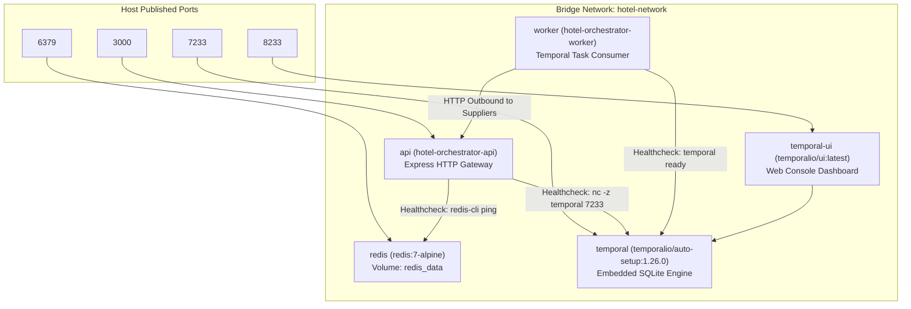

# 10. Docker & Deployment Guide

## 1. Overview of Container Topology

The **Hotel Offer Orchestrator** is packaged using a multi-stage Docker build and coordinated via Docker Compose into five isolated microservices communicating over a private bridge network (`hotel-network`).



---

## 2. Dockerfile Walkthrough (Line-by-Line)

The `Dockerfile` employs a **two-stage build** to optimize image size and security:

```dockerfile
# Stage 1: Builder stage
FROM node:20-alpine AS builder

WORKDIR /app

# 1. Copy package definitions first to maximize Docker layer cache hits
COPY package*.json tsconfig.json ./
RUN npm ci

# 2. Copy source files and compile TypeScript into dist/
COPY src ./src
RUN npm run build

# Stage 2: Production runtime stage
FROM node:20-alpine AS runner

WORKDIR /app

# 3. Set production environment
ENV NODE_ENV=production

# 4. Install only runtime production dependencies (no TypeScript compiler in final image)
COPY package*.json ./
RUN npm ci --omit=dev

# 5. Copy compiled JavaScript from builder stage
COPY --from=builder /app/dist ./dist

# 6. Run as non-privileged 'node' user for defense-in-depth container security
USER node

EXPOSE 3000

# 7. Default command launches the Express API server
CMD ["node", "dist/server.js"]
```

### Advantages of This Multi-Stage Strategy:
- **Small Footprint**: Development tools (`typescript`, `ts-jest`, `@types/*`) are pruned from the final image, reducing image size from > 600MB to ~140MB.
- **Security**: The runtime container executes as user `node` rather than `root`, mitigating container breakout vulnerabilities.

---

## 3. Docker Compose Services

### 1. `redis`
- **Image**: `redis:7-alpine`
- **Persistence**: Mounted to named volume `redis_data:/data` with `--appendonly yes` (AOF durability).
- **Healthcheck**: Tests `redis-cli ping` every 5 seconds.

### 2. `temporal`
- **Image**: `temporalio/auto-setup:1.26.0`
- **Configuration**: Uses embedded `DB=sqlite` and automatically provisions the `default` namespace on first launch.
- **Note on Production**: Single-node SQLite auto-setup is specifically for local demonstration and evaluation. In enterprise production, Temporal requires an external distributed database cluster (PostgreSQL, Cassandra, or MySQL) and horizontally scaled frontend, matching, and history services.
- **Healthcheck**: Validates TCP port `7233` listening state before dependent services start.

### 3. `temporal-ui`
- **Image**: `temporalio/ui:2.30.0` (pinned stable tag)
- **Port Mapping**: `8080:8080` (accessible at `http://localhost:8080`).
- **Dependencies**: Awaits `temporal` healthy condition.

### 4. `api`
- **Image**: Built from `Dockerfile`.
- **Port Mapping**: `3000:3000`.
- **Service Discovery**: Connects to `REDIS_HOST=redis` and `TEMPORAL_ADDRESS=temporal:7233`.
- **Dependencies**: Won't start until both `redis` and `temporal` report healthy.

### 5. `worker`
- **Image**: Built from the identical `Dockerfile`.
- **Command Override**: `["node", "dist/workers/worker.js"]`.
- **Service Discovery**: Resolves supplier mock endpoints via `SUPPLIER_A_URL=http://api:3000/supplierA/hotels`.

---

## 4. How to Deploy & Run

### Step 1: Clone and Inspect Environment
Ensure `.env` exists (or copy from `.env.example`):
```bash
cp .env.example .env
```

### Step 2: Build and Start Containers
```bash
docker compose up --build
```

### Step 3: Verify Running Services
```bash
docker compose ps
```
All containers (`hotel-orchestrator-api`, `hotel-orchestrator-worker`, `hotel-orchestrator-redis`, `hotel-orchestrator-temporal`, `hotel-orchestrator-temporal-ui`) should show state `healthy` or `running`.

### Step 4: Access Endpoints
- **Express API**: `http://localhost:3000/api/hotels?city=delhi`
- **Health Status**: `http://localhost:3000/health`
- **Temporal Web UI**: `http://localhost:8233` (explore active and completed workflows)

---

## 5. Operations & Troubleshooting

### Inspecting Service Logs
```bash
# Follow logs for all services
docker compose logs -f

# Follow logs for API container only
docker compose logs -f api

# Follow logs for Temporal Worker only
docker compose logs -f worker
```

### Stopping the Services
```bash
# Stop containers gracefully
docker compose down

# Stop containers and delete persistent volumes
docker compose down -v
```

### Rebuilding a Single Service (e.g. Worker)
```bash
docker compose build worker
docker compose up -d worker
```
